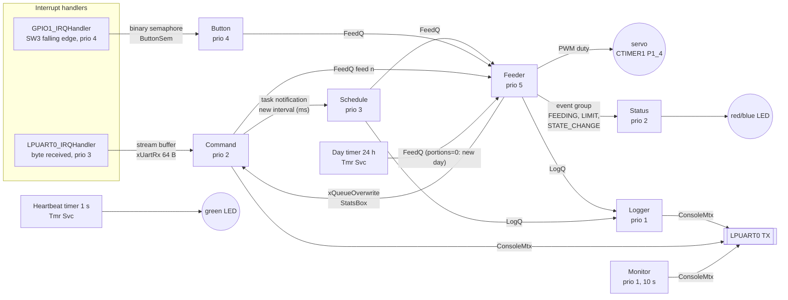

# High-level design — pet feeder

7 tasks + the timer service task, 2 interrupt handlers. The names below are
exactly the names used in the code (`source/app_tasks.c`, `board/bsp_mcxa153_regs.c`) and the
ones shown in the MCUXpresso FreeRTOS Task List / Queue List views.

## Flow of one meal

1. A request lands in **FeedQ**. It comes from the Schedule task (interval
   timeout), the Button task (after debounce), the Command task (`feed n`) or
   the Day timer (portions = 0 means "new day: reset the counter").
2. **Feeder** (highest priority) takes the request and checks:
   - cooldown: `APP_FEED_COOLDOWN_MS` since the end of the last meal,
     otherwise REJECTED;
   - daily limit: `APP_MAX_PORTIONS_PER_DAY`, otherwise REJECTED + red LED.
3. If accepted: set `FEEDING` → Status turns on the blue LED. For each portion:
   servo to `SERVO_ANGLE_OPEN`, wait settle + open time, servo closed, wait
   settle. Clear `FEEDING`.
4. Feeder publishes the stats in **StatsBox** and sends a log message to
   **LogQ**. The **Logger** prints it when nothing more urgent is ready.

A request that arrives *while* the Feeder is busy waits in FeedQ. When it is
processed, it falls inside the cooldown and is rejected. This is the rule
that test scenario 3 breaks on purpose.

## Who owns what

| Resource | Owner | Others access it via |
|----------|-------|----------------------|
| servo | Feeder only | FeedQ requests |
| portion counter, stats | Feeder only | StatsBox (read-only copy) |
| feed interval | Schedule only | task notification |
| UART TX | shared | ConsoleMtx |

## RAM budget

See the comment at `configTOTAL_HEAP_SIZE` in `source/FreeRTOSConfig.h`.
**TODO(eni):** after the first board run, paste the `MON … heapFree / minEver`
and stack lines here and adjust the stack sizes.
