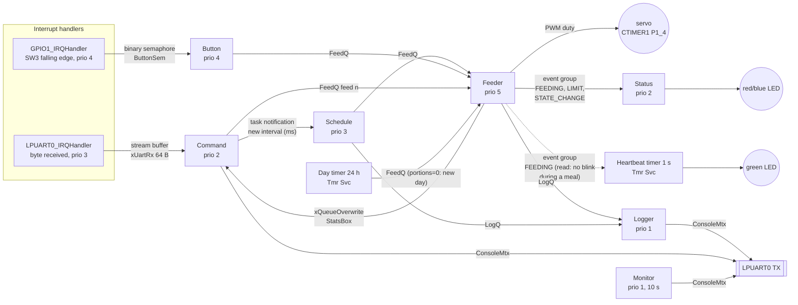

# High-level design — pet feeder

7 tasks + the timer service task, 2 interrupt handlers. The names below are
exactly the names used in the code (`source/app_tasks.c`,
`board/bsp_mcxa153_regs.c`): the task names appear in the debugger's RTOS
Details view, the queue and semaphore names in the FreeRTOS queue registry
(`vQueueAddToRegistry`).

## Flow of one meal

1. A request lands in **FeedQ**. It comes from the Schedule task (interval
   timeout), the Button task (after debounce), the Command task (`feed n`) or
   the Day timer (portions = 0 means "new day: reset the counter").
2. **Feeder** (highest priority) takes the request and checks:
   - cooldown: `APP_FEED_COOLDOWN_MS` since the end of the last meal,
     otherwise REJECTED;
   - daily limit: `APP_MAX_PORTIONS_PER_DAY`, otherwise REJECTED + red LED.
3. If accepted: set `FEEDING` → Status turns on the blue LED. For each portion:
   servo to `SERVO_ANGLE_OPEN`, wait settle + open time, servo closed, wait
   settle. Clear `FEEDING`.
4. Feeder publishes the stats in **StatsBox** and sends a log message to
   **LogQ**. The **Logger** prints it when nothing more urgent is ready.

A request that arrives *while* the Feeder is busy waits in FeedQ. When it is
processed, it falls inside the cooldown and is rejected. This is the rule
that test scenario 3 breaks on purpose.

## Who owns what

| Resource | Owner | Others access it via |
|----------|-------|----------------------|
| servo | Feeder only | FeedQ requests |
| portion counter, stats | Feeder only | StatsBox (read-only copy) |
| feed interval | Schedule only | task notification |
| UART TX | shared | ConsoleMtx |

## RAM budget

Measured on the board on 2026-10-09 (debug build, demo timing). The MCXA153
has 32 KB of SRAM, of which the linker script gives 24 KB to data
(`m_data`). The build uses **18 360 B (75 %)**:

| Part | Size | Source |
|------|-----:|--------|
| FreeRTOS heap (`ucHeap`, heap_4) | 14 336 B | `configTOTAL_HEAP_SIZE` |
| Main stack (MSP: `main()` before the scheduler, then all ISRs) | 2 048 B | `STACK_SIZE` in `armgcc/MCXA153_flash.ld` |
| C library heap (unused by the application) | 1 024 B | `HEAP_SIZE` in the linker script |
| Kernel lists, queue registry, newlib state, application globals | ~950 B | `.data` / `.bss` |

**Inside the FreeRTOS heap**, everything is allocated in `app_create()`
before the scheduler starts. The Monitor task reports `heapFree=872
minEver=872` for the whole run, so **13 464 B is in use** and the heap never
changes after start-up. The course value of 12 KB would not fit.

**Task stacks** (allocated from the heap), sizes from `app_config.h`, peak use
from the RTOS Details view (stack high-water mark) and the Monitor's
`stackFree` line:

| Task | Stack | Peak use | Free at peak | Peak caused by |
|------|------:|---------:|------:|----------------|
| Feeder | 256 words (1 KB) | 232 B | 77 % | servo loop, log message on the stack |
| Button | 256 words | 152 B | 85 % | debounce loop |
| Schedule | 256 words | 504 B | 51 % | `snprintf` for "interval now …" |
| Command | 384 words (1.5 KB) | 296 B | 81 % | line buffer and parsing |
| Status | 256 words | 180 B | 82 % | LED logic |
| Logger | 384 words | 624 B | 59 % | `app_printf`: 100 B buffer + `vsnprintf` |
| Monitor | 384 words | 624 B | 59 % | two formatted `MON` lines |
| IDLE | 256 words | 104 B | 90 % | kernel |
| Tmr Svc | 256 words | 224 B | 78 % | day and heartbeat callbacks |

**Conclusion:** every task keeps at least half of its stack free, and
`configCHECK_FOR_STACK_OVERFLOW = 2` would report an overflow by name. The
stacks are larger than needed: Feeder, Button and Status could go to 128
words, which would free 1.5 KB of heap. They were left as they are,
because the RAM isn't needed for anything else and the margin protects
against stack growth when the code changes. The heap has 872 B left, so a new
task or queue needs a bigger `configTOTAL_HEAP_SIZE`. There is room for it:
6 KB of the 24 KB data region is still free.
