# Test scenarios — pet feeder

Each scenario has an **expected behaviour** (timing diagram) and the **actual
behaviour** from the RTOS-aware debugger.

How the diagrams were made: the expected diagrams follow from the design.
They were checked in the PC simulator from the design phase (FreeRTOS POSIX
port, kept outside this repository), which runs the same application code,
injects the button presses and UART commands from a script
(`sim/bsp_posix.c`) and logs every context switch to `sim_trace.csv`.
`tools/trace_to_ascii.py` turns a time window into a diagram.
Tick = 1 ms. Demo timing (`APP_DEMO_TIMING = 1`).

**Actual behaviour on the board:** each scenario was run on the
FRDM-MCXA153 under the debugger (MCUXpresso for VS Code, configuration
"Debug pet_feeder (J-Link)"). At breakpoints placed at moments in the
expected diagram, the task states were captured from the *RTOS Details* view
and the kernel objects (queue fill levels, semaphore counts, Feeder locals)
from the Watch window. Console logs are in `test_logs/`. Each scenario
compares expected and actual behaviour in a table.

---

## Scenario 1: UART command → meal (ISR, stream buffer, queue, event group)

**Goal:** typed characters arrive through an interrupt, are assembled into a
command by a low-priority task, and the resulting request preempts it at
once, because the Feeder has a higher priority.

**Input:** `feed 2` + Enter at t = 2000 ms.

**Expected** (simulator, 2000–2010 ms, 20 switches):

```
tick      | 2001 2002 2003 2004 2005 2006 2007
Command   |  #    #    #    #    #    #    # #     one RX ISR per char -> stream buffer
Feeder    |  .    .    .    .    .    .    #       '\n' -> FeedQ -> Feeder preempts Command
Status    |  .    .    .    .    .    .    #       FEEDING bit -> blue LED on
order @2007: Command -> Feeder (servo 90 deg, then blocks in vTaskDelay)
             -> Status -> Command (finishes) -> IDLE
then: 2907 servo 0 deg, 3207 servo 90 deg, 4107 servo 0 deg, 4407 blue LED off,
      Logger prints "FED 2 portion(s) (command), today 2/6"
```

**Actual (board, 2026-10-09):** debug build, "Debug pet_feeder (J-Link)",
RTOS Details view of MCUXpresso for VS Code. That view only lists tasks, so
the FeedQ fill level is read in the Watch window from the kernel's queue
struct: `((struct QueueDefinition *)xFeedQueue)->uxMessagesWaiting` /
`->uxLength`. Console log:
[test_logs/2026-10-09_scenario1_console.txt](test_logs/2026-10-09_scenario1_console.txt).

*Stop 1:* breakpoint at `request_feed(FEED_COMMAND …)` in `CommandTask`
(`app_tasks.c:237`), after typing `feed 2`.

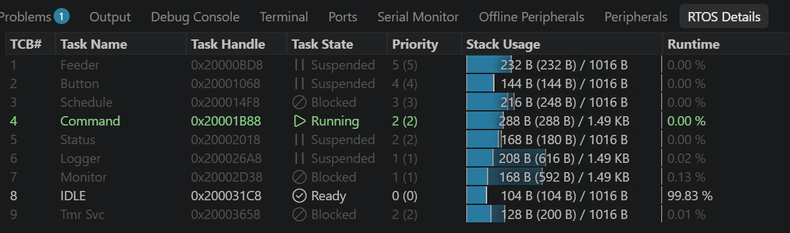
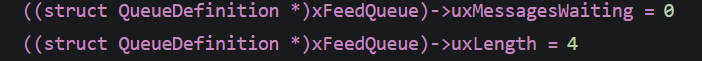

| | Expected | Observed |
|---|---|---|
| Command | Running | Running |
| Feeder | Blocked on FeedQ | Suspended |
| FeedQ | 0 / 4 | 0 / 4 |

Feeder, Button, Status and Logger show *Suspended*, not *Blocked*: they wait
with `portMAX_DELAY`, and with `INCLUDE_vTaskSuspend = 1` FreeRTOS keeps such a
task on the suspended list (no timeout to track). Schedule, Monitor and Tmr Svc
wait with a timeout and show *Blocked*.

*Stop 2:* breakpoint on the first line after `xQueueReceive` in `FeederTask`
(`app_tasks.c:140`), reached with Continue (F5) from stop 1.

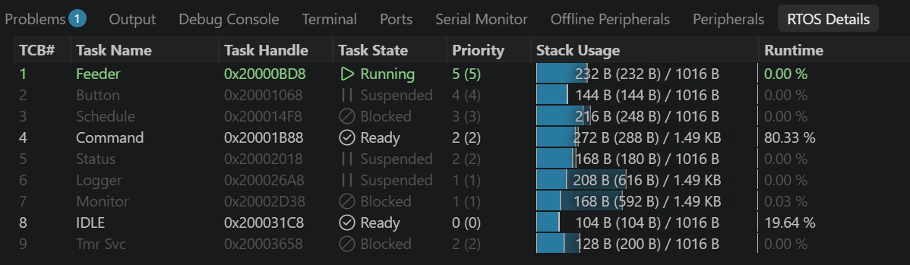
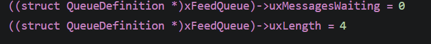

| | Expected | Observed |
|---|---|---|
| Feeder | Running | Running |
| Command | Ready (preempted) | Ready |
| FeedQ | request in and taken out at once | 0 / 4 |

FeedQ is never seen at 1/4 with these breakpoints: the Feeder (priority 5)
preempts the Command task inside `xQueueSend` and empties the queue before
any breakpoint in the Command task can be reached. The Runtime column is not
meaningful across breakpoints: CTIMER2 keeps counting while the core is
halted, and that time is charged to the task that was running at the stop
(Command 80 % at stop 2).

*Outcome:* the `feed 2` of this run was `REJECTED command: cooldown`
(tick 221 218). It arrived 18 ms after the scheduled meal of tick 220 000
ended (1 portion = 1.2 s), inside `APP_FEED_COOLDOWN_MS` (2 s). A second try
at tick 302 557 was rejected the same way (1.36 s after a scheduled meal).
The simulator run sends `feed 2` at 2000 ms, far from any scheduled meal, so
it never meets the cooldown. Repeated without breakpoints after
`interval 60` (next scheduled meal 60 s away): `FED 2 portion(s) (command),
today 6/6` at tick 578 167. The servo opened and closed twice, and the
day counter went from 4/6 to 6/6.

**Comparison:**

| Aspect | Expected | Actual | Verdict |
|---|---|---|---|
| Preemption | Feeder (prio 5) takes over from Command (prio 2) as soon as the request is queued | Stop 2: Feeder Running, Command Ready | match |
| FeedQ | 1/4 → 0/4 | 0/4 at both stops | the 1/4 state can't be seen: the Feeder empties the queue inside the same `xQueueSend` call. Confirms the immediate preemption |
| Waiting tasks | Feeder *Blocked* on FeedQ | Feeder *Suspended* | naming only: an indefinite wait is kept on the suspended list. Expectation should read "waiting (Suspended)" |
| Run-time % | not part of the expectation | Command 80 % at stop 2 | debugger artefact: CTIMER2 runs while the core is halted |
| `feed 2` outcome | `FED 2 portion(s)` | first two tries `REJECTED command: cooldown`, `FED 2` after `interval 60` | behaviour correct (cooldown requirement), but the test input timing matters: on the board the schedule keeps running, in the simulator script it was not near a meal |

The RTOS mechanisms (ISR → stream buffer → Command task → FeedQ → Feeder,
priority preemption) behave as designed. The deviations come from how the
debugger shows kernel state and from the test setup, not from the application.
To make the scenario repeatable, set `interval 60` before sending `feed 2`.

**Conclusion:** the test confirmed that a console command reaches the Feeder
through the UART interrupt, the stream buffer and FeedQ, and that the Feeder
takes over the CPU as soon as the request is queued, because it has the
higher priority. Two things differed from what I expected. The debugger shows
tasks that wait forever as Suspended, not Blocked. And my first `feed 2` was
refused, because a scheduled meal had just finished and the 2 s cooldown was
still running. That showed me the safety rule works for every source, and
that on the real board the schedule keeps running during a test, unlike in my
simulator script. Next time I set `interval 60` first, so the test is
repeatable.

*TODO(eni): draft written with AI help, edit into your own words.*

---

## Scenario 2: button during a meal, debounce and cooldown

**Goal:** a sporadic interrupt is deferred to a task and debounced, a bounce
does not cause a second request, and a request that arrives while the servo
is moving is rejected by the cooldown rule.

**Input:** SW3 pressed at t = 3000 ms with a bounce at 3005 ms, while the
`feed 2` meal from scenario 1 is still running.

**Expected** (simulator, 2900–4410 ms, 19 switches):

```
2907 Feeder   servo closed after portion 1, blocks (settle)
3001 Button   takes ButtonSem, sleeps 30 ms (debounce); bounce @3005 gives it again
3031 Button   drains the extra give, pin still low -> FeedQ (1 request waiting)
3207 Feeder   portion 2, servo open
4107 Feeder   servo closed
4407 Feeder   meal done -> takes the button request from FeedQ ->
              0 ms since the meal ended < 2000 ms cooldown -> REJECTED
     Status, Logger: "FED 2 …", "REJECTED button: cooldown"
Monitor later: btnIrq=2 (2 edges), 1 request
```

**Actual (board, 2026-10-09):** debug build, "Debug pet_feeder (J-Link)",
RTOS Details for the task list, Watch window for the kernel objects:
`((struct QueueDefinition *)xFeedQueue)->uxMessagesWaiting` / `->uxLength`,
`((struct QueueDefinition *)xButtonSem)->uxMessagesWaiting` and the ISR
counter `g_buttonIrqs`. Input: `feed 2`, then SW3 while the blue LED is on.
Console log: [test_logs/2026-10-09_scenario2_console.txt](test_logs/2026-10-09_scenario2_console.txt).

*Stop A:* `app_tasks.c:188`, the debounce delay, just after the Button task
took ButtonSem (run 2).

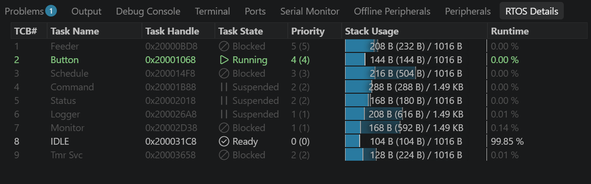
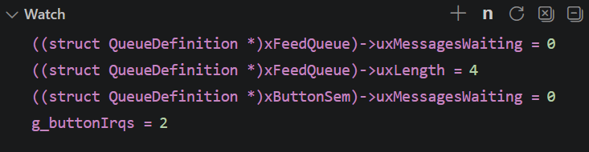

| | Expected | Observed |
|---|---|---|
| Button | Running (woken by the SW3 ISR) | Running |
| Feeder | Blocked (servo delay, meal in progress) | Blocked |
| ButtonSem | 0 (just taken) | 0 |
| `g_buttonIrqs` | +1 for this press | 2 (1 from run 1 + this press) |
| FeedQ | 0 / 4 | 0 / 4 |

*Stop B:* `app_tasks.c:187`, the Button task is back at `xSemaphoreTake`
after sending its request (run 2). The core clock is halted at a breakpoint,
so the 30 ms debounce only starts on Continue. SW3 was therefore held down
while continuing from stop A; otherwise the pin check after the debounce sees
a released button. Pressing SW3 while halted also latches a new falling
edge, which acts as a bounce during the debounce window.

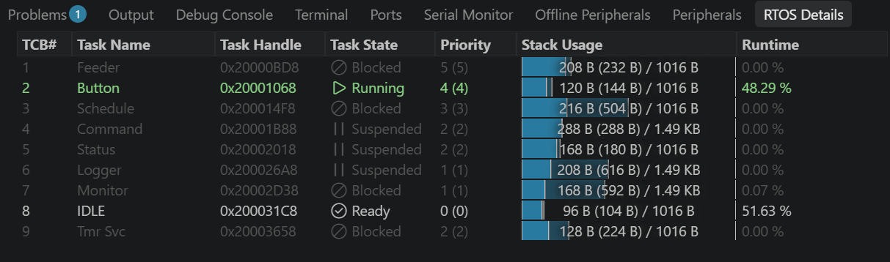
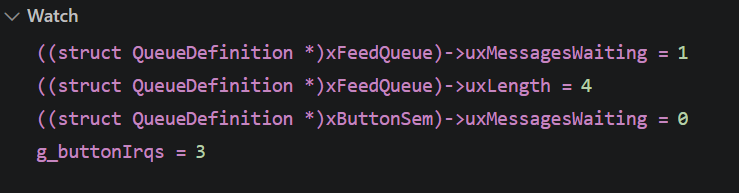

| | Expected | Observed |
|---|---|---|
| Button | Running | Running |
| Feeder | Blocked (still in the meal) | Blocked |
| FeedQ | 1 / 4: the request waits, the Feeder is busy | 1 / 4 |
| ButtonSem | 0: the extra give is drained at line 189 | 0 |
| `g_buttonIrqs` | 3: the extra edge is counted, but gives no extra request | 3 |

Run 2 result: `[650152] FED 2 portion(s) (command)`, then
`[652552] REJECTED button: cooldown`: 650 152 + 2 400 ms meal = 652 552, so
the request was handled 0 ms after the meal ended.

*Stop C:* `app_tasks.c:152`, the cooldown rejection in `FeederTask` (run 3,
after a board reset, schedule back at 20 s, breakpoints A and B disabled).

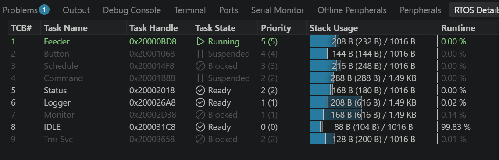
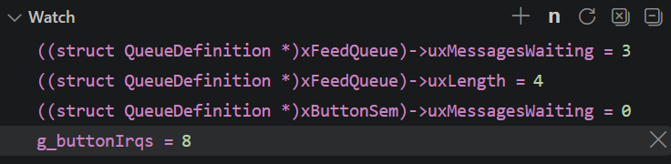

| | Expected | Observed |
|---|---|---|
| Feeder | Running | Running |
| Button | Suspended (waits forever on ButtonSem) | Suspended |
| Status, Logger | about to show the meal result | Ready: woken by the event bit and LogQ, but lower priority than the Feeder |
| FeedQ | 0 / 4 (one button request, taken) | 3 / 4 |
| `g_buttonIrqs` | 1 (one press) | 8 |

Run 3 result:
```
[1258835] FED 2 portion(s) (command), today 4/6     meal 1 258 835 .. 1 261 235
[1261235] REJECTED schedule: cooldown                schedule due at 1 260 000, during the meal
[1261235] REJECTED button: cooldown
[1261235] REJECTED button: cooldown
[1261235] REJECTED button: cooldown
MON ... btnIrq=8
```
So at stop C the Feeder was rejecting the *scheduled* request, and the three
requests still in FeedQ were all from one SW3 press. FeedQ held 4 of 4
during the meal: a fifth request would have been dropped (`dropFeed`).

**Comparison:**

| Aspect | Expected | Actual | Verdict |
|---|---|---|---|
| Deferred interrupt handling | ISR gives ButtonSem, Button task (prio 4) runs | stop A: Button Running, ButtonSem 0 | match |
| Request queued during a meal | waits in FeedQ until the Feeder is free | stop B: FeedQ 1/4, Feeder Blocked | match |
| Cooldown after the meal | button request rejected 0 ms after the meal | runs 2 and 3: rejected at exactly the end of the meal | match |
| Priority order after the meal | Feeder first, then Status and Logger | stop C: Status and Logger Ready, Feeder Running | match |
| Bounce during the debounce | extra edge drained, one request | run 2: 3 IRQs, 1 request | match |
| One press, long bounce | 1 request | run 3: 8 IRQs, 3 requests | **mismatch**: the switch chatters for longer than `APP_BUTTON_DEBOUNCE_MS` (30 ms), so later bounces start a new debounce cycle that still reads the pin as pressed |
| Other sources | not part of the input | a scheduled request arrived during the meal (20 s schedule) | test setup: set `interval 60` before the test |

The cooldown rule in the Feeder hides the debounce problem from the pet:
every extra request is rejected. But the extra requests do fill FeedQ, and
with a full queue a legitimate request (for example the new-day marker) could
be dropped.

**Tasks involved in the error:** the GPIO1 ISR (gives ButtonSem on every
falling edge, bounces included), the Button task (debounce and pin check) and,
through FeedQ, the Feeder. The ISR and the Feeder behave correctly; the error
is in the Button task's debounce, which only looked at the first 30 ms of a
press.

**Fix:** two options were considered.
1. A longer debounce (50–100 ms): one line, but a bounce longer than the new
   value still gives an extra request, and every press gets slower.
2. Wait for the release (chosen): after a request the Button task polls SW3
   every `APP_BUTTON_POLL_MS` (10 ms) until it has read *released* for
   `APP_BUTTON_DEBOUNCE_MS` (30 ms) in a row, and only then drops the edges
   collected in ButtonSem. However long the switch bounces or is held, one
   press gives one request. Cost: the Button task wakes every 10 ms while SW3
   is held, which is negligible.

**Re-test after the fix** (board, all breakpoints disabled, `interval 60`):
[test_logs/2026-10-09_scenario2_debounce_fix.txt](test_logs/2026-10-09_scenario2_debounce_fix.txt)

| Test | Result | `btnIrq` |
|---|---|---|
| one short press | `[26252] FED 1 portion(s) (button)`, no other request | 0 → 1 |
| SW3 held for about 3 s | `[35527] FED 1 portion(s) (button)`, one request | 1 → 2 |
| `feed 2`, SW3 once during the meal | `[48102] FED 2 portion(s) (command)`, one `[50503] REJECTED button: cooldown` | 2 → 3 |

In this run SW3 did not bounce (one interrupt per press), so the long bounce
of run 3 was not reproduced against the new code. The re-test shows that the
fix keeps the normal behaviour and handles a held button; the long-bounce case
is covered by construction (no new request before 30 ms of stable release).

**Conclusion:** the deferred interrupt handling works as designed: the SW3
interrupt only gives a semaphore, the Button task does the debouncing, and a
button request that arrives during a meal waits in FeedQ and is rejected by
the cooldown as soon as the meal ends. With the debugger I could see the
request waiting in the queue, which was not possible in scenario 1, where the
Feeder took it immediately. The test also showed something the simulator
could not: the real SW3 sometimes bounces much longer than 30 ms, so one press
produced three requests. The cooldown kept the pet from being fed twice, but
the bounce requests filled FeedQ. I fixed this in the Button task by waiting
for a stable release before accepting the next press, and re-tested it on the
board.

*TODO(eni): draft written with AI help, edit into your own words.*

---

## Scenario 3: double feeding (deliberate mismatch)

**Goal:** a comprehensive situation (more than 10 task switches, several
communication paths) where the actual behaviour does **not** match the
requirement, and finding the cause.

**Requirement:** a button press during a scheduled meal must not give the pet
a second meal ("max 1 meal per cooldown period").

Build with `APP_FAULT_MODE=1`. The Feeder no longer checks the cooldown.
Input: `interval 10` at 5000 ms, so the next scheduled meal comes at
~15 000 ms. SW3 is pressed at 15 300 ms, during that meal.

**Expected (normal build, 14990–16215 ms, 20 switches):**

```
15012 Schedule -> FeedQ -> Feeder (servo 90) -> Schedule -> Status (blue on)
15302 Button (debounce) ... 15332 Button -> FeedQ (waits, Feeder busy)
15912 Feeder servo 0
16212 Feeder meal done; takes button request -> REJECTED (cooldown)
      -> Status (blue off) -> Logger
```

**Actual (fault build, 14990–17420 ms, 28 switches):**

```
15013 Schedule -> Feeder (servo 90) -> Schedule -> Status
15301 Button ... 15331 Button -> FeedQ
15913 Feeder servo 0
16213 Feeder: takes button request, no cooldown check -> servo 90 again
      -> Status -> Logger ("FED 1 (schedule)")
17113 Feeder servo 0
17413 Feeder done -> Status -> Logger ("FED 1 (button), today 5/6")
```

Mismatch: the pet got 2 meals 0 ms apart (`today` 4 → 5), and the blue LED
stays on for 2.4 s instead of 1.2 s.

**Analysis:** tasks involved: Button (producer), Schedule (producer), Feeder
(consumer) and FeedQ. The queue works correctly. It stores the button request
while the Feeder is busy and hands it over afterwards. The error is in the
Feeder's rules: with no cooldown, a request that was queued during a meal is
carried out right after it. Because the Feeder has the highest priority, it
starts the second meal straight away, before the Logger has even printed the
first one. You can see this in the trace: Logger runs only after Feeder
blocks again.

**Solution:** the cooldown check in `FeederTask` (normal build), measured from
the *end* of the previous meal. Alternatives considered:
1. Flush FeedQ after each meal (`xQueueReset`): this also drops legitimate
   requests such as the new-day marker, so it's rejected.
2. Ignore the button while `FEEDING` is set (check in ButtonTask): this
   doesn't cover the `feed` command, so the rule belongs in the Feeder, which
   owns the servo.

**Actual on the board (2026-10-09):** build with `APP_FAULT_MODE = 1` and
`APP_DEMO_TIMING = 1`, "Debug pet_feeder (J-Link)", one breakpoint on
`m.kind = LOG_FED` (`app_tasks.c:174`, reached at the end of every meal).
`interval 10` after reset, SW3 pressed once while the blue LED of a scheduled
meal was on. Watch: FeedQ fill level and the Feeder's locals `r.source`
(who asked for this meal), `now` (meal start), `st.last_feed_tick` (meal end)
and `st.portions_today`. Console log:
[test_logs/2026-10-09_scenario3_console.txt](test_logs/2026-10-09_scenario3_console.txt).

*Hit 1:* end of the scheduled meal.

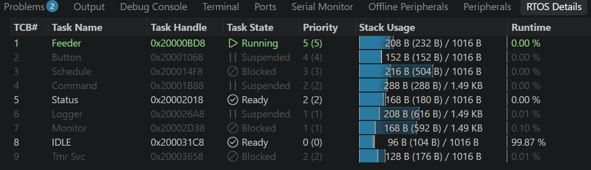
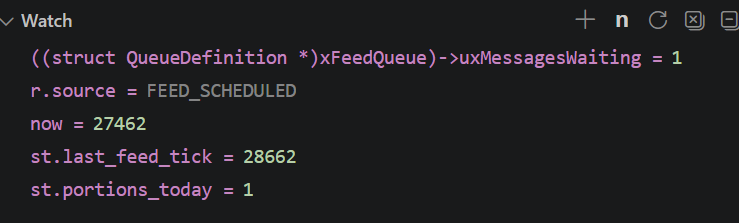

*Hit 2:* reached with Continue (F5), 1.2 s later, without any other input.

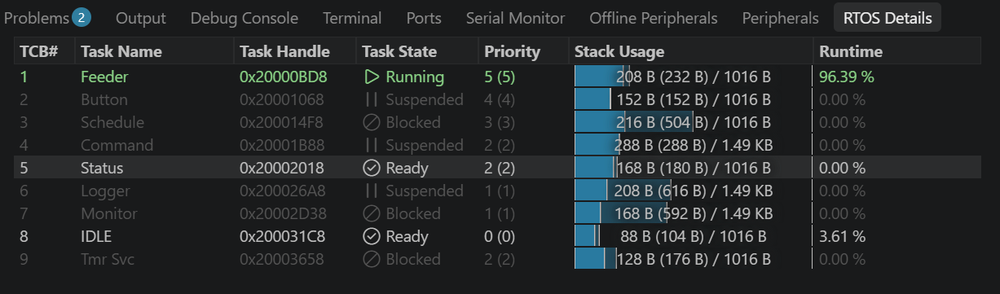
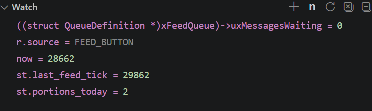

| | Hit 1 | Hit 2 |
|---|---|---|
| `r.source` | `FEED_SCHEDULED` | `FEED_BUTTON` |
| meal start (`now`) | 27 462 | 28 662 |
| meal end (`st.last_feed_tick`) | 28 662 | 29 862 |
| `st.portions_today` | 1 | 2 |
| FeedQ | 1 / 4 (button request waiting) | 0 / 4 |
| Feeder | Running | Running |
| Status | Ready (woken to switch the LED off, lower priority) | Ready |
| Logger | Suspended (first meal not logged yet) | Suspended (first meal logged during meal 2) |

Console:
```
[  27462] FED 1 portion(s) (schedule), today 1/6
[  28662] FED 1 portion(s) (button), today 2/6
```

**Comparison:**

| Aspect | Expected (normal build) | Actual (fault build, board) | Verdict |
|---|---|---|---|
| Button request during the meal | waits in FeedQ | hit 1: FeedQ 1/4 | match |
| After the scheduled meal | button request rejected (cooldown) | second meal started at 28 662 = end of the first meal, 0 ms gap | **mismatch** (the injected fault) |
| Portions | `today` 1/6 | `today` 2/6 | **mismatch**: the pet got 2 meals |
| Blue LED | on for 1.2 s | on for 2.4 s | **mismatch** |
| Order of tasks | Feeder first, then Status and Logger | Feeder takes the next request from FeedQ without blocking; Logger prints meal 1 only while the Feeder is blocked in meal 2 | as in the simulator trace |
| Timing | — | board ticks identical to the simulator's prediction (meal = 1 200 ms, second meal at the end tick of the first) | match |

The board shows the same error as the simulator trace above, with the same
cause. The debugger pins it down to one place: at hit 2 `r.source` is
`FEED_BUTTON` and `now` equals the previous `st.last_feed_tick`, so the
Feeder accepted a request 0 ms after a meal. The queue, the Button task and
the Schedule task all did their job; the missing rule is the cooldown check
in `FeederTask`, which `APP_FAULT_MODE = 1` compiles out
(`app_tasks.c:149-155`). With `APP_FAULT_MODE = 0` the same input gives
`REJECTED button: cooldown` (scenario 2, runs 2 and 3).

**Conclusion:** this scenario shows how a missing rule in one task causes an
error that only appears through the interaction of several tasks. The
Schedule and Button tasks both produced a correct request, and FeedQ kept the
button request safe while the Feeder was busy, exactly as designed. But
because the Feeder has the highest priority and found a request waiting, it
started the second meal in the same tick the first one ended, before the
Status and Logger tasks had even run. The RTOS-aware debugger made this
visible: `r.source` and the two tick values showed which request caused the
second meal and that there was no gap at all. The fix belongs in the Feeder,
because it is the only task that drives the servo and sees every request,
whatever its source.

*TODO(eni): draft written with AI help, edit into your own words.*

---

## Extra test: daily limit and console commands (board, console log)

**Goal:** the Feeder stops feeding once `APP_MAX_PORTIONS_PER_DAY` (6) is
reached, from every source, until the day timer starts a new day. Unknown
commands get the help text.

**Log:** [test_logs/2026-10-07_console_daily_limit.txt](test_logs/2026-10-07_console_daily_limit.txt)
(normal build, demo timing, timestamps in ticks of 10 ms: this run used the
course tick rate of 100 Hz; `configTICK_RATE_HZ` was raised to 1000 Hz
afterwards, see `source/FreeRTOSConfig.h`).

| Tick (s) | Event | Expected | Observed |
|---|---|---|---|
| 14000 → 20000 (140–200 s) | 4 scheduled + 2 `feed` commands | fed, `today` counts 1/6 → 6/6 | as expected |
| 17424 / 18000 | `feed`, then scheduled meal 5.8 s later | both fed (more than 2 s cooldown) | as expected |
| 22000 (220 s) | scheduled meal at 6/6 | rejected, red LED on | `REJECTED schedule: daily limit` |
| 22568 | `feed 2` at 6/6 | rejected | `REJECTED command: daily limit` |
| 24000 (240 s) | day timer | `NEW DAY`, counter 0, red LED off | `NEW DAY` |
| — | `f`, `nn`, `interval` (no value) | help text | help text |
| whole run | Monitor | no drops, heap stable | `dropRx/dropFeed/dropLog=0`, `heapFree=872` constant |

*TODO(eni): conclusion in your own words, and whether you saw the red LED
between 220 s and 240 s.*

---

*Optional extra (fault mode 2):* without the console mutex, the output of the
Command `status` reply and the Logger can interleave. This shows why the mutex
is needed.

---

## Found on the board: HardFault at startup (2026-10-07)

Not a planned scenario. This was a real fault found the first time the
application ran on the FRDM-MCXA153, after it had only been run in the PC
simulator. It is listed here because it is a mismatch between expected and
actual behaviour that was found and fixed with the debugger.

**Expected:** after reset the banner is printed, the scheduler starts, and
`help` / `status` on the console get a reply.

**Actual:** the banner was printed, then nothing. No reply to any command, no
LED activity. Normal build, `APP_FAULT_MODE = 0`.

**How it was found** (SEGGER J-Link Commander, because the MCU-Link probe has
J-Link firmware instead of the NXP firmware LinkServer needs):

1. Halt the core a few seconds after reset: `PC = 0x00000318`, which `nm`
   shows is `HardFault_Handler`, and `IPSR = 3` (HardFault). `PSP` holds no
   valid task stack (`0x04002F28`), so no task had run yet: the fault came
   before or during `vTaskStartScheduler()`.
2. Read the fault status registers (Cortex-M33, System Control Block):

   | Register | Address | Value | Meaning |
   |---|---|---|---|
   | CFSR | `0xE000ED28` | `0x00008200` | BusFault: `PRECISERR` (bit 9) + `BFARVALID` (bit 15) |
   | HFSR | `0xE000ED2C` | `0x40000000` | `FORCED`: the BusFault was escalated to a HardFault |
   | BFAR | `0xE000ED38` | `0x4000600C` | Faulting address |

3. `0x4000600C` = `CTIMER2_BASE` (`0x40006000`) + `0xC` = `CTIMER2->PR`.
   The only code that writes it is `vConfigureTimerForRunTimeStats()` in the
   course `runtime_stats.c`, which FreeRTOS calls from
   `vTaskStartScheduler()` through `portCONFIGURE_TIMER_FOR_RUN_TIME_STATS()`.
4. Read the MRCC registers after the fault: CTIMER2 was never set up.

   | Register | Value | CTIMER2 part |
   |---|---|---|
   | `MRCC_GLB_RST0` | `0x60080008` | bit 4 = 0: CTIMER2 still in reset |
   | `MRCC_GLB_CC0` | `0x60480008` | bit 4 = 0: CTIMER2 bus clock off |
   | `MRCC_CTIMER2_CLKSEL` / `CLKDIV` | `0x7` / `0x40000000` | reset values, divider halted |

   `runtime_stats.c` does write these registers, so the writes were
   being ignored.

**Cause:** `clocks_and_resets()` in `bsp_mcxa153_regs.c` unlocked the clock
registers (`SYSCON->CLKUNLOCK`), set up CTIMER1, LPUART0 and the ports, and then
**locked them again** with `clk_lock()`. When `runtime_stats.c` ran later, its
MRCC writes for CTIMER2 were silently ignored. CTIMER2 stayed in reset with no
clock, so its first register access (`CTIMER2->PR = 1000-1`) gave a precise
BusFault. With no BusFault handler enabled, it was escalated to a HardFault.
Two board-layer parts that each worked on their own failed together.

**Fix:** removed the `clk_lock()` call, so the clock registers stay unlocked,
as they are after reset and as the course examples expect. The reason is
written as a comment next to `clk_unlock()` in `bsp_mcxa153_regs.c`.

**Check after the fix:** rebuilt (flash 26 320 B, RAM 18 360 B) and flashed.
`help` and `status` reply on the console, `feed` gives
`FED 1 portion(s) (command), today 1/6`, and a scheduled meal right after it
is `REJECTED schedule: cooldown`, as designed.

**Why the simulator missed it:** the PC simulator replaces the board layer
(`bsp.h` is the only seam), so register-level clock setup is never run
there. Faults in the board layer only appear on the real hardware.

**What I learned:** a HardFault is not a dead end. The fault status
registers say what kind of fault it was (here a precise BusFault, escalated
to a HardFault), and BFAR gives the exact address that was accessed. Looking
that address up in the device header pointed straight at the CTIMER2
register and the one function that writes it. The real cause was not in that
function but in an earlier, unrelated one that locked the clock registers:
two parts that each worked on their own failed together, and the write that
"didn't happen" left no error behind. Since then, when a peripheral faults
on its first access, I check its clock and reset bits first.

*TODO(eni): draft written with AI help, edit into your own words. Optional:
reproduce it (put `clk_lock();` back at the end of `clocks_and_resets()`) and
take a screenshot of the fault registers in the debugger's peripheral/register
view.*
