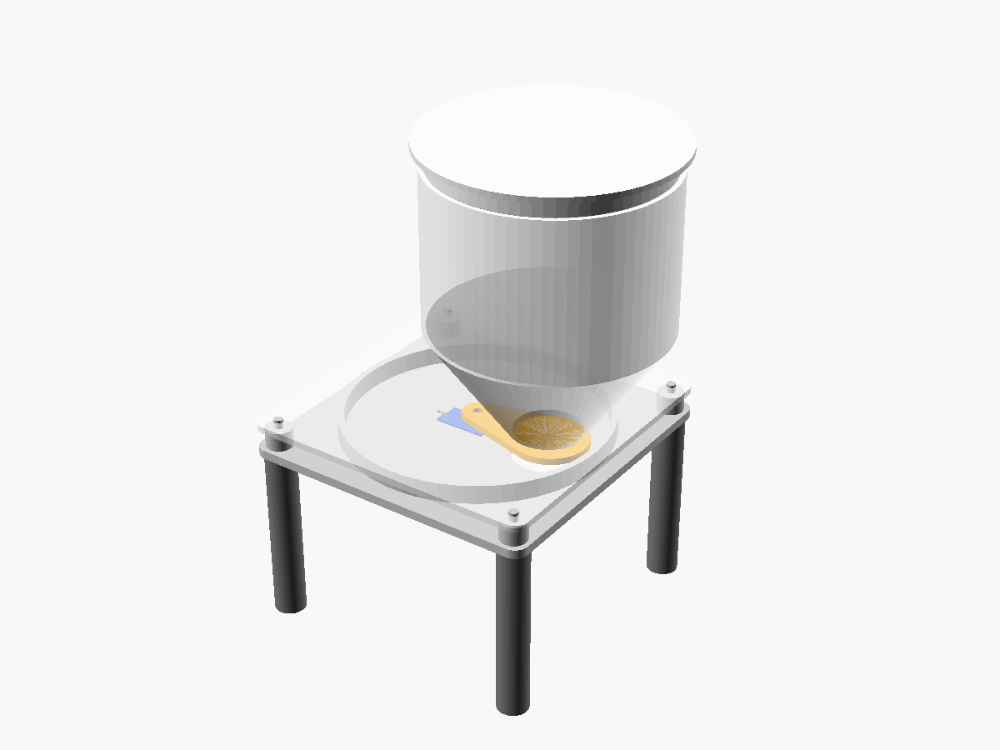
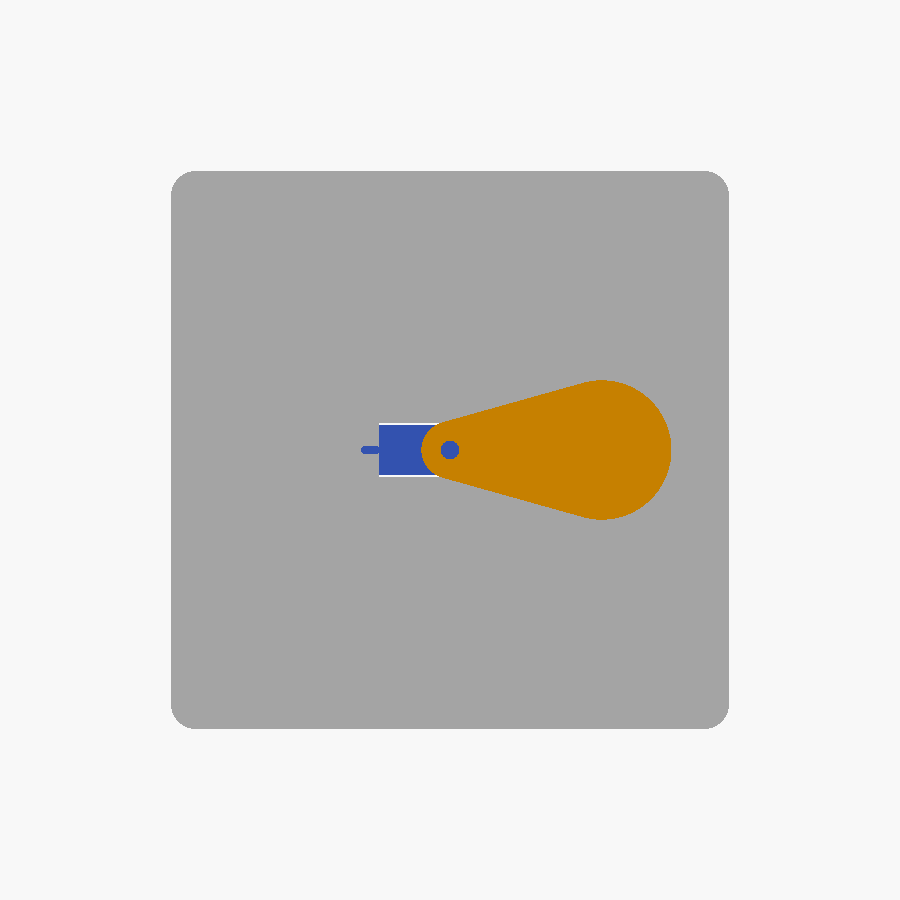

# Feeder mechanics (3D printed)

Gravity hopper with a swinging gate driven by the SG90 (milestone M4). The
gate is a flat paddle on the servo horn that slides under the hopper outlet:
closed at `SERVO_ANGLE_CLOSED`, open at `SERVO_ANGLE_OPEN` (`source/app_config.h`).
While it's open, kibble falls through the base into the bowl underneath.



| Closed | Open |
|---|---|
|  |  |

The model is parametric: [`feeder.scad`](feeder.scad) (OpenSCAD). Every size
is a variable at the top of the file.

## Parts

| Part | Qty | Size (mm) | Print orientation |
|------|----:|-----------|-------------------|
| `servo_test` | 1 | 50 × 55 × 4 | flat, print this first |
| `gate` | 1 | 61 × 34 × 3 | flat side down (as exported) |
| `base` | 1 | 136 × 136 × 16.5 | plate down |
| `hopper` | 1 | 156 × 136 × 123 | flange down |
| `lid` | 1 | 110 × 110 × 10.5 | top down |
| `leg` | 4 | 14 × 14 × 90 | standing, peg up |

Export a part to STL (or open the file in OpenSCAD, set `part`, press F6 and
export):

```
openscad -D "part=\"base\"" -o stl/base.stl feeder.scad
```

STL files are generated, so they are not in git (`mechanics/stl/`).

**Print settings:** PLA or PETG, 0.2 mm layers, 3 walls, 15–20 % infill, no
supports. PETG is the better choice for parts that touch food; either way,
only use it for dry kibble and clean it regularly.

**Hardware:** the SG90, its single-arm horn and the two small screws that
come with it; a drop of glue for the horn in the gate if the fit is loose.

## Step 1: test fit

Print `servo_test` (about 15 minutes) before the big parts.

1. Push the SG90 up through the rectangular cut-out until the tabs touch the
   plate, and screw the tabs on from below. If the body doesn't fit, raise
   `tol` (or `sg_len` / `sg_wid`) in `feeder.scad`.
2. Press the single-arm horn into the pocket of the small paddle. It should
   be a snug fit.
3. With the servo mounted and the horn on the shaft, measure the height of
   the horn's underside above the top of the plate. Put that value in
   `horn_bottom_z` (default 4.5 mm). The gate height and the chamber height
   are calculated from it.

## Step 2: print and assemble

1. Print the gate, base, hopper, lid and 4 legs.
2. Push the legs into the sockets under the base.
3. Mount the SG90 under the base, shaft up through the cut-out.
4. Run the firmware once so the servo goes to `SERVO_ANGLE_CLOSED`. Put the
   horn on the shaft so the paddle covers the drop hole, then screw the horn
   on and press the gate onto it.
5. Place the hopper on the 4 alignment pins and fill it.

## Step 3: calibrate

- **Gate angles:** the horn only fits on the shaft in steps of a few degrees,
  so fine-tune `SERVO_ANGLE_CLOSED` until the paddle fully covers the outlet,
  and `SERVO_ANGLE_OPEN` until it fully clears it.
- **Portion size (one tablespoon):** type `feed` on the console and weigh or
  measure what comes out. Adjust `SERVO_OPEN_TIME_MS` until one portion is
  about one tablespoon. Repeat a few times with a full and a nearly empty
  hopper, because the flow changes a little with the fill level.

## Design notes

- Outlet 30 mm, about 3× the size of a kibble piece, so the food doesn't
  bridge over the hole.
- Funnel walls at 55° from horizontal: steeper than the angle at which dry
  kibble stops sliding (about 30–40°), and printable without supports.
- Hopper volume about 730 ml, roughly 8 days at 6 portions a day.
- The gate slides 1 mm under the hopper flange, so kibble is cut off cleanly
  when it closes. The SG90 (1.8 kg·cm) pushes the paddle through a piece
  that is in the way.
- Servo screw holes are slots, because SG90 clones differ by up to about
  0.6 mm.
